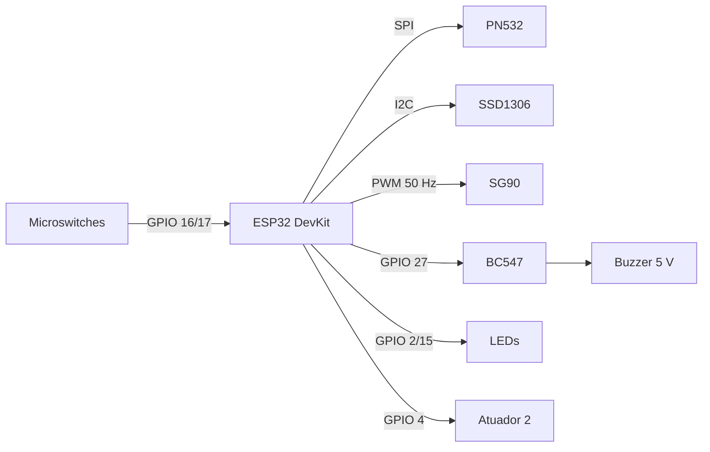

# Armário Inteligente de Notebooks

Firmware ESP32 e interface web embarcada de um armário que controla retirada e devolução de notebooks por cartão NFC. Trabalho da disciplina Performance em Sistemas Ciberfísicos (PUCPR, 2026/2).

> **Estado atual:** compila e passa nos testes unitários, mas **ainda não foi executado em hardware real**. Use `docs/TESTES.md` para a validação em bancada.

## Visão geral

- **Core 1:** interação física (NFC, máquina de estados, tranca, LEDs, buzzer, OLED).
- **Core 0:** comunicação e armazenamento (Wi-Fi, web, flash, métricas, amostragem, energia).
- **Web sem internet:** todas as páginas e o Chart.js ficam no LittleFS.
- **Persistência:** 1000+ logs, histórico de 24 h e de 7 dias, 1000+ eventos de empréstimo.

Detalhes em [docs/ARQUITETURA.md](docs/ARQUITETURA.md).

## Ligações

| Componente | GPIO | Observações |
|---|---|---|
| PN532 SCK / MISO / MOSI / SS | 18 / 19 / 23 / 5 | Coloque as chaves do módulo em **modo SPI** (1 OFF, 2 ON) |
| OLED SDA / SCL | 21 / 22 | I²C, endereço 0x3C |
| Servo (sinal) | 13 | Alimentação 5 V com capacitor de 1000 µF |
| Microswitch slot 1 / 2 | 16 / 17 | C no GND, NA no GPIO |
| LED verde / vermelho | 2 / 15 | Resistor de 330 Ω; o LED azul da placa acende junto com o verde |
| Buzzer | 27 | Base do BC547 por 1 kΩ; buzzer ativo de 5 V no coletor |
| Segundo atuador | 4 | **Pendente**, ver abaixo |

Quase tudo fica do lado do 3V3 do DevKit de 30 pinos. Do lado do VIN ficam só o servo e o buzzer, que já usam o 5 V do VIN. Não ligue nada no GPIO 12: nível alto nele no boot muda a tensão da flash e a placa não inicia.



Todos os GNDs precisam ser comuns. Não alimente o servo pelo pino de 3,3 V.

## Como compilar e gravar

Requer PlatformIO. Na primeira vez, o toolchain e as bibliotecas são baixados sozinhos, nas versões fixadas no `platformio.ini`.

### Preparar o PC (uma vez só)

Arch:

```bash
sudo pacman -S --needed git python python-pipx gcc
pipx install platformio && pipx ensurepath
sudo usermod -aG uucp $USER   # acesso à porta serial; saia e entre de novo na sessão
```

Fedora:

```bash
sudo dnf install git pipx gcc-c++
pipx install platformio && pipx ensurepath
sudo usermod -aG dialout $USER   # acesso à porta serial; saia e entre de novo na sessão
```

Baixar o código:

```bash
git clone https://github.com/gengibrepower/Armario-Inteligente
cd Armario-Inteligente
git switch pinagem-nova-sem-porta
```

Se a placa não aparecer em `/dev/ttyUSB0` ou `/dev/ttyACM0`, troque o cabo: muitos cabos USB só carregam e não transmitem dados.

### Compilar, gravar e acompanhar

```bash
pio run                  # compila o firmware
pio run -t upload        # grava o firmware
pio run -t uploadfs      # grava as páginas web
pio device monitor       # acompanha os logs pela USB
```

Se houver mais de uma porta serial, indique qual: `pio run -t upload --upload-port /dev/ttyUSB0`. Em caso de crash, o monitor já mostra o backtrace com arquivo e linha (`esp32_exception_decoder`).

**Atenção:** `uploadfs` substitui a partição inteira e **apaga usuários, logs e histórico**. Antes de regravar um armário em uso, baixe o backup em Admin → Sistema. Atualizações de firmware pela aba Performance (OTA) preservam esses dados.

### Testes unitários

```bash
pio test -e native   # roda no PC, sem placa; usa o gcc instalado acima
```

### Build de demonstração

```bash
pio run -e esp32dev-sim -t upload   # grava 24 h de histórico fictício no primeiro boot
```

## Primeiro acesso

1. Ligue o armário. Sem rede configurada, ele cria o Wi-Fi **Armario-Setup**, senha **armario-setup**.
2. Conecte-se e abra `http://192.168.4.1/admin.html`.
3. Entre com usuário **admin** e senha **admin**. O sistema obriga a trocar a senha antes de liberar qualquer função.
4. Em Admin → Configurações, busque a rede, informe a senha e salve. O IP aparece no rodapé do OLED.
5. Em Admin → Usuários, clique em **Cadastrar cartão** e aproxime o cartão.
6. Preencha `data/www/about.json` com nomes, e-mails e link do repositório, e rode `pio run -t uploadfs`.

## Pendências

| Item | Responsável |
|---|---|
| **Confirmar o segundo atuador com a equipe.** O TDE exige dois atuadores que não sejam LED nem buzzer, e só o servo existe. O firmware já aciona um relé (iluminação/cooler) no GPIO 4 enquanto o armário está destrancado; `AUX_ACTUATOR_ENABLED` e `AUX_ACTIVE_LEVEL` ficam em `include/config.h`. | Equipe |
| Executar `docs/TESTES.md` e anexar as evidências | Equipe |
| Ajustar os ângulos do servo e os tempos de sessão na bancada | Equipe |
| Preencher nomes, e-mails e GitHub em `data/www/about.json` | Equipe |
| Conferir pilhas das tasks pelo high water mark e reduzir as folgadas | Equipe |

## Limitações conhecidas

- **HTTP sem TLS:** login e cookie trafegam sem criptografia. Use em rede controlada.
- **Dados pessoais:** com "Dashboard e Performance públicas" ligado, quem acessar a rede vê nomes de usuários. Desligue essa opção se o uso exigir, considerando a LGPD.
- **Sem sensor de porta:** a sessão é uma janela de tempo depois do cartão. Não há alarme de porta esquecida aberta nem de arrombamento; uma porta forçada só é detectada se um slot mudar.
- **Dormindo, o cartão não acorda o armário:** no Light Sleep, só o timer e uma mudança de slot acordam; no Deep Sleep, só o timer, e um slot mexido durante esse sono não vira violação. Durante o sono ninguém consegue retirar notebooks.
- **Modo econômico automático:** reduz a CPU a 80 MHz fora do horário; não liga o modem sleep.
- **Backup sem segredos:** não leva a senha do Wi-Fi nem a do admin.
- **Volume do bipe:** o buzzer é ativo, então o PWM apenas recorta o som; o efeito precisa ser avaliado na bancada.

## Créditos

Chart.js 4.4.9 (licença MIT), Adafruit PN532/SSD1306/GFX (BSD), ArduinoJson (MIT), ESPAsyncWebServer e AsyncTCP (LGPL-3.0).
