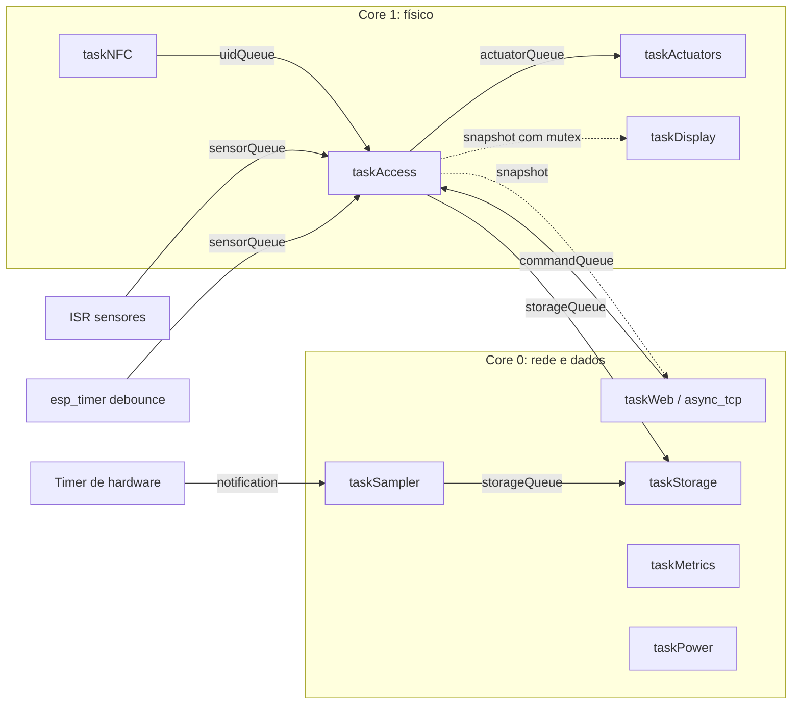

# Arquitetura

Base para o capítulo "Desenvolvimento do Sistema". Os valores marcados como *estimativa* devem ser substituídos pelas medições da bancada.

## Tasks e cores

O core 0 hospeda a pilha Wi-Fi (prioridade 23) e o lwIP. Colocar a interação física no core 1 impede que uma rajada de pacotes atrase um cartão ou o servo.

| Task | Core | Prior. | Pilha (B) | Função e justificativa |
|---|---|---|---|---|
| `taskAccess` | 1 | 6 | 5120 | Máquina de estados. Maior prioridade: decidir sobre um evento recebido vem antes de buscar outro |
| `taskNFC` | 1 | 5 | 4096 | Polling do PN532. Dorme enquanto espera o RF |
| `taskActuators` | 1 | 4 | 3072 | Ciclo de 10 ms dos padrões, só GPIO e LEDC |
| `taskDisplay` | 1 | 1 | 3584 | ~5 Hz; os ~25 ms de I²C não podem atrasar a tranca |
| `taskWeb` | 0 | 3 | 6144 | Wi-Fi, reconexão, estado no WebSocket, confirmação de OTA |
| `async_tcp` | 0 | lib | 8192 | Servidor HTTP/WebSocket |
| `taskSampler` | 0 | 2 | 3072 | Acordada por timer de hardware; atraso distorceria o histórico |
| `taskPower` | 0 | 2 | 4096 | Sono e frequência; passa a vida bloqueada |
| `taskStorage` | 0 | 1 | 6144 | Único escritor da flash; prioridade mínima deixa a rede fluir |
| `taskMetrics` | 0 | 1 | 6144 | Coleta a 1 Hz; só serializa com cliente conectado |

A `taskPower` não constava da tabela do prompt: entrar em sono exige esperar flush e rádio, o que não cabe num handler web. As pilhas são valores iniciais, a validar pelo high water mark.

**Regras de concorrência:** toda comunicação usa fila, event group, task notification, mutex ou atômico. `taskAccess` espera UID, sensores e comandos num `QueueSet`, sem polling. Quem lê configurações ou o estado recebe uma cópia, então não segura mutex durante o próprio trabalho.

**Limite real da separação por core:** escrever na flash desabilita o cache, o que pausa brevemente os dois cores. Por isso nenhuma task física toca na flash, e os usuários ficam em RAM. Ainda assim, durante uma escrita o core 1 sofre um atraso curto, medido indiretamente pelo máximo de `lock_actuate`. A task `arduino_events` roda no core 1 por configuração pré-compilada do core Arduino.

## Máquina de estados

Pura (`src/core/state_machine.*`): recebe eventos e tempo, devolve ações. Por isso é testada no PC.

O armário não tem sensor de porta. A sessão é uma janela de tempo aberta pelo cartão: a tranca solta, os slots podem mudar e, quando a janela acaba, o saldo é gravado e a tranca volta.

```mermaid
stateDiagram-v2
  [*] --> IDLE
  IDLE --> OPEN: cartão autorizado ou destrancar pela web
  OPEN --> OPEN: slot mudou (prazo = atraso para trancar)
  OPEN --> OPEN: cartão de novo (prazo reinicia; outro usuário grava o saldo do anterior)
  OPEN --> IDLE: prazo acabou ou trancar pela web; grava e tranca
  IDLE --> ALARM: slot mudou trancado
  ALARM --> IDLE: silenciado (web ou cartão admin)
  IDLE --> ENROLL: cadastro pela web
  ENROLL --> IDLE: cartão, cancelamento ou timeout
```

Decisões a defender:
- **Grava o saldo da sessão**, não cada transição: tirar e repor o mesmo notebook não é empréstimo.
- **Cada mudança de slot redefine o prazo para o atraso de trancar** (3 s por padrão): quem já retirou não espera a janela inteira, e quem continua mexendo não é trancado no meio.
- **Sem sensor de porta, o reset sempre começa trancado:** não há como saber se havia alguém mexendo no armário.
- **Crédito do empréstimo vem do id gravado na ação:** o próximo cartão durante a sessão grava o saldo do anterior antes de assumir.
- **O que se perde sem a porta:** alarme de porta esquecida aberta, de arrombamento e o acordar pela porta. Uma porta forçada só é detectada se um slot mudar.

## Interrupções

1. Borda no GPIO: ISR `IRAM_ATTR` conta e envia `Edge` por `xQueueSendFromISR`.
2. `taskAccess` reinicia um `esp_timer` de 30 ms; novas bordas adiam a janela.
3. O timer envia `Settled`; a task lê o nível e só então gera evento.
4. Uma verificação a cada 1 s reavalia os níveis, cobrindo fila cheia e retorno do sono.

O timer de hardware (`timerBegin`) notifica a `taskSampler` no período configurado. A página Performance mostra o total de interrupções, evidência de quantas bordas o debounce absorveu.

## Medição de desempenho

- **CPU:** o prompt supunha que `configGENERATE_RUN_TIME_STATS` estava desligado, mas no core 3.3 ele está ativo com base de 1 µs. Usamos `uxTaskGetSystemState`: uso = 100% − fatia do IDLE. Comparado ao idle hook, dispensa calibração, independe da frequência, dá o percentual por task e preserva o `waiti`, que economiza energia.
- **Tempo de funções:** RAII com `esp_timer_get_time()` em `nfc_read`, `card_validate`, `lock_actuate`, `log_write`, `oled_render`, `json_serialize` e `history_write`.

## Energia

| Modo | Como entra | Acorda por | O que mantém |
|---|---|---|---|
| Normal | Padrão | — | Tudo |
| Modem sleep | Configuração | — | Conexão Wi-Fi |
| CPU 80/160 MHz | Configuração ou econômico automático | — | Tudo |
| Light Sleep | Botão web | Timer, mudança de slot | RAM e tasks; Wi-Fi desligado |
| Deep Sleep | Botão web | Timer | RTC; reinicia ao acordar |

Antes de dormir: recusa se houver sessão aberta, aguarda a resposta HTTP, grava o log com flush, corta o sinal do servo e desliga o rádio. Os slots (GPIO 16/17) não são RTC GPIO, então no deep sleep só o timer acorda, e um slot mexido durante esse sono não vira violação. O GPIO do buzzer recebe pull-down RTC, evitando polarizar o BC547. Comparar consumos exige medir em bancada.

## Web

`/www` no LittleFS é a única árvore pública; cadastro e logs ficam fora dela. REST para consultas e comandos, WebSocket para estado (ao mudar) e desempenho (1 Hz). Exportações usam resposta em blocos lendo o anel aos poucos, para não montar 1000 registros em RAM sem PSRAM.

Senha: SHA-256 com sal e 2000 iterações, em NVS. Sessão: token aleatório em cookie `HttpOnly` e `SameSite=Strict`, com expiração por inatividade. Cinco falhas bloqueiam o login por 60 s.

OTA: confere cabeçalho e chip antes de apagar a flash, grava na partição inativa e valida no final. A imagem entra em estado pendente e só é confirmada após 60 s funcionando; se travar antes, o bootloader volta à anterior.

## Persistência

| Partição | Tamanho | Uso |
|---|---|---|
| nvs | 20 KB | Configurações, senha, empréstimos ativos |
| otadata | 8 KB | Partição de boot |
| app0 / app1 | 1,69 MB cada | Firmware (bin atual: 1,68 MB) |
| spiffs | 576 KB | LittleFS |

O prompt sugeria apps de ~1,5 MB e LittleFS de ~900 KB, mas o firmware não cabe nesse tamanho. O PlatformIO exibe ~91%, porém ignora o alinhamento: a referência correta é o tamanho do `firmware.bin`, que deixa ~91 KB de margem.

| Anel | Segmentos × registros | Retém | Disco (*estimativa*) |
|---|---|---|---|
| Logs | 9 × 125 | 1000 a 1125 | 144 KB |
| Eventos | 9 × 125 | 1000 a 1125 | 72 KB |
| Minutos | 7 × 240 | 24 a 28 h | 56 KB |
| Horas | 8 × 24 | 7 a 8 dias | 32 KB |

Com ~150 KB de páginas, o uso esperado é de cerca de 460 KB de 576 KB (*estimativa*; o valor real aparece na Performance).

**Buffer circular segmentado.** O prompt sugeria um arquivo único com índice. No LittleFS, alterar o início de um arquivo reescreve tudo até o fim dele, então cada log custaria dezenas de blocos. Usamos segmentos só de acréscimo: a posição deriva do número de sequência, e o índice é refeito no boot pelo último registro válido de cada segmento. Cada registro tem CRC, e uma cauda corrompida por queda de energia é descartada.

**Redução de desgaste:**
- Lote em RAM com flush a cada 30 s, a cada 32 logs ou imediato em ERROR e eventos de empréstimo.
- Amostras agregadas por minuto e gravadas a cada 10 min (perder alguns minutos é aceitável).
- Usuários só regravam ao mudar, com arquivo temporário e `rename` atômico.
- *Estimativa* de pior caso, com um flush de 2 blocos a cada 30 s sem parar e ~144 blocos: 40 ciclos por dia, ou mais de 6 anos até os 100 mil ciclos típicos.

## Memória

Sem PSRAM, o desenho evita alocação em caminho crítico: buffers de WebSocket estáticos, respostas em blocos, usuários e estatísticas em tabelas fixas, e no máximo 4 clientes WebSocket.

## Bibliotecas e `delay()`

O código do projeto não chama `delay()`. As bibliotecas Adafruit usam `delay()` internamente, o que no ESP32 equivale a `vTaskDelay`: a task dorme e o core fica livre. Isso ocorre na `taskNFC`, ao esperar o PN532. Limitamos as tentativas do chip (`setPassiveActivationRetries`) para que uma leitura curta não cancele uma busca em andamento.
